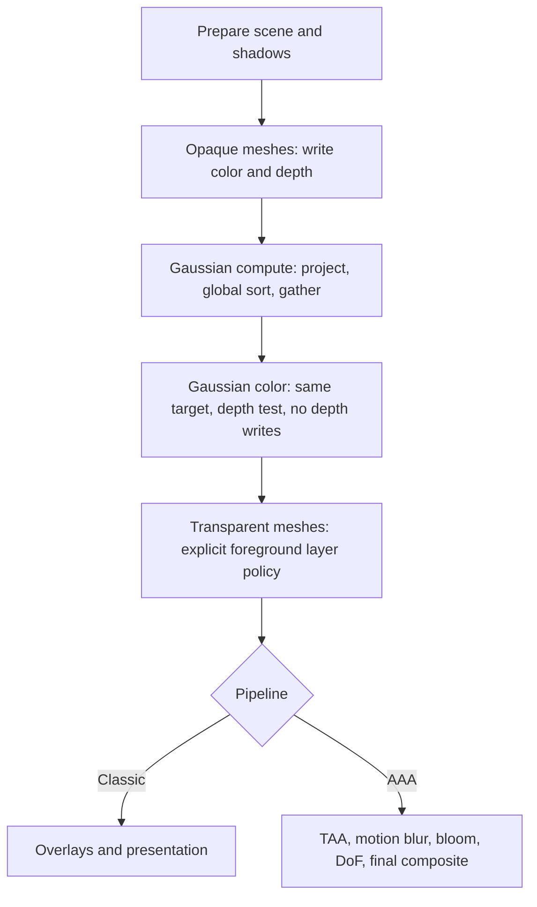

# Gaussian splatting in the forward pipeline: feasibility and minimal integration

Date: 2026-11-11. Status: feasibility study; proposed pipeline extensions are not implemented by this document.

Source reviewed: HARFANG3D `c2ddbe0767ee7f2d88dd1e99b1d92aa3a12bf3ef`, including the native Gaussian renderer, classic forward and AAA submission paths, canonical shaders and bindings.

## 1. Recommendation

**Integration is feasible without replacing the forward renderer or introducing a second rasterizer.** Reuse `SubmitGaussianSplats` and render into the forward pass's existing framebuffer, preserving its depth attachment. The existing GPU depth test already supplies mesh/splat occlusion at the splats' projected center depth.

Proceed in two small steps:

1. **Classic forward, opaque scene: no engine changes.** Submit the scene, then submit all overlapping Gaussian instances together to the same target, with the same camera and viewport and `depth_test = true`.
2. **Controlled pass placement and AAA: add an opt-in Gaussian insertion between opaque and transparent mesh rendering.** Call the existing native renderer there. In AAA, target `aaa.frame_hdr_fb` and use the exact jittered projection used by the meshes. Preserve the existing entry points and behavior when the insertion is absent.

Do **not** enable Gaussian depth writes in the normal alpha-blended color pass. A Gaussian cloud has transparency and multiple contributions along a ray; one nearest-depth value cannot describe that composition. An optional representative depth or proxy mesh can be added later for specific consumers, with an explicit approximation contract.

| Requested outcome | Feasibility | Smallest useful change |
| --- | --- | --- |
| Opaque meshes hide splats behind them | Already supported by the native renderer | Share the existing target/depth attachment and enable depth testing |
| Splats appear in front of opaque meshes when nearer | Already supported at center depth | Render opaque meshes first, then blend the surviving Gaussian fragments |
| One reusable Z-buffer containing mesh and splat surfaces | Feasible only with a chosen splat surface approximation | Optional proxy geometry or separate representative-depth pass |
| Arbitrary translucent meshes interleaved with splats | Not solved by sharing Z | A substantially broader transparency strategy |
| Gaussian color included in AAA HDR/post-processing | Feasible, with qualifications | Internal insertion, identical jitter, explicit color policy and temporal validation |
| Full AAA normals, velocity, GI, reflections and depth effects for splats | Additional development | Surface/attribute representation beyond the minimal integration |

## 2. What the repository already provides

The native renderer is substantially further along than a standalone experimental splat viewer. The following are observations from the current source, rather than new API proposals.

| Evidence | Current behavior | Integration consequence |
| --- | --- | --- |
| [`gaussian_splat.h`](../harfang/engine/gaussian_splat.h), `SubmitGaussianSplats` | Accepts a `ViewState`, viewport rectangle, instances, persistent renderer/render data, settings and a BGFX framebuffer handle | The application or pipeline already supplies the camera and destination |
| [`gaussian_splat.cpp`](../harfang/engine/gaussian_splat.cpp), submission/draw setup | Configures its own compute/graphics views, selects the supplied target, uses sequential graphics order and `BGFX_CLEAR_NONE`; never calls `Frame` | A separate view can preserve an earlier pass's color and depth |
| Same source, draw state | Adds `BGFX_STATE_DEPTH_TEST_LESS` when `settings.depth_test` is true | Existing hardware depth comparison can use opaque mesh depth |
| [`compute.cpp`](../harfang/engine/compute.cpp), `ComputePremultipliedRenderState` | RGB/A writes and `ONE / INV_SRC_ALPHA` blending, without depth writes | Preserve this state for Gaussian color composition |
| [`project.sc`](../core-package/core/gaussian_splatting/project.sc) and [`splat_vs.sc`](../core-package/core/gaussian_splatting/splat_vs.sc) | Store projected center NDC depth and assign it to every vertex of each screen-space quad, with clip `w = 1` | Occlusion uses a constant center depth across each Gaussian footprint |
| [`splat_fs.sc`](../core-package/core/gaussian_splatting/splat_fs.sc) | Computes Gaussian alpha, discards beyond three standard deviations and below `1/255`, clamps alpha to `0.99`, emits premultiplied RGB | No opaque surface depth is derived in the fragment shader |
| [`scene_forward_pipeline.cpp`](../harfang/engine/scene_forward_pipeline.cpp), classic submission | Opaque pass followed by transparent pass, both targeting the supplied `fb`; opaque pass owns scene clearing | Appending splats is immediately useful for opaque-only scenes; insertion is needed to choose their relationship to mesh transparency |
| Same source, AAA construction | `aaa.attributes_fb` and `aaa.frame_hdr_fb` attach the same `aaa.depth` D24 texture; HDR color is RGBA16F | AAA already has a reusable hardware depth attachment |
| Same source, AAA submission | Attribute pass, screen-space lighting work, opaque/transparent HDR passes, TAA, motion blur, bloom, DoF and final output | Submit Gaussian color inside this sequence to include it in post-processing |
| [`bind_harfang.py`](../binding/bind_harfang.py) | Gaussian submit/settings/instances and target handle are bound; `ForwardPipelineAAA` exposes no framebuffer/depth members | The classic composition is accessible from Lua; AAA internals should be passed to a native integration helper |

Canonical Gaussian shaders live under `core-package/core/gaussian_splatting`; tutorial copies must remain synchronized through the repository's core-package tooling. No HGS2 format, importer or source-data change is required for shared-depth composition.

### Existing evidence and a fresh check

The existing [`gaussian_splat_native_probe.lua`](../harfang/tests/gaussian_splat_native_probe.lua) already draws an opaque blue triangle at view-space `z = 2.5`, a red Gaussian at `z = 3`, and a green Gaussian at `z = 2`. All share an RGBA8+D24 framebuffer. It expects a center pixel near `(0, 0.5, 0.5, 1)`: the triangle rejects red, while green blends over blue. A constant, unrelated splat depth would fail this test.

For this study, the existing GPU probe was rerun on 2026-11-11 using the installed Windows Lua runtime and compiled tutorial shaders, for **both float32 and quantized HGS2 fixtures**. Both runs passed, including the mesh-depth pixel oracle, depth-test negative controls, compact/expanded schedules and cached/fresh composition checks. The probe asserts the actual renderer is Direct3D 11.

This was an installed-binary check, **not a fresh build of the reviewed HEAD**. The runtime log identifies build `d52560d6ada51b7a8b005ac874d83eb8f8ebb2cd`, built 2026-11-09. Reproduction used `Harness` and `test_gpu_probe` from [`test_gaussian_splat_native.py`](../harfang/tests/test_gaussian_splat_native.py), with:

```text
renderer:     dx11
lua/module:   tutorials/hg_lua
gsplatc:      tutorials/hg_lua/harfang/assetc/toolchains/host-windows-x64-target-windows-x64/gsplatc.exe
shaders:      tutorials/resources_compiled/core/gaussian_splatting
mesh shaders: tutorials/resources_compiled/shaders
```

Local, unversioned evidence is in `C:/works/dev/harfang/.codex_tmp/gsplat-forward-feasibility/`: `summary.json`, the two `logs/gpu_lua_*.log` files and `gpu-*/opaque_mesh_composition.png`. These temporary files are not build dependencies.

Prior [Windows native performance validation](SPECS_GAUSSIAN_SPLATTING_NATIVE_PERFORMANCE.md) and [Metal validation](GSPLAT_MACOS_OPTIMIZED_VALIDATION.md) also cover native composition. They do not establish full forward/AAA integration. This study did not run a new forward-scene or AAA prototype.

## 3. What “mixing the Z-buffers” means

### 3.1 Prefer one shared depth attachment

The smallest integration has no two-buffer merge operation:

```text
Opaque mesh pass -> color C + hardware depth Dmesh
Gaussian pass    -> same color C + depth-test against Dmesh, no depth writes
```

For the current normal-Z convention, a Gaussian fragment survives when:

```text
z_center(x, y) < Dmesh(x, y)
```

Surviving fragments are composed far to near using premultiplied alpha:

```text
Cnew = alpha * Cgaussian + (1 - alpha) * Cold
Anew = alpha + (1 - alpha) * Aold
```

This gives both visible relationships for **opaque** geometry: meshes hide Gaussian centers behind them, and nearer splats blend over mesh color. Rendering all opaque geometry first is sufficient; those meshes do not need to read a splat-populated depth buffer afterward.

The output depth nevertheless remains mesh-only. That distinction matters for later geometry, depth picking and post-effects. A visually correct opaque/splat composition does not imply that all depth consumers can see the Gaussian cloud.

Use the same framebuffer handle wherever practical. Two different framebuffer objects may also share the same depth texture when attachment formats, dimensions, sample counts and lifetimes are compatible, but there is no benefit to adding that indirection for the initial integration. Two independent depth textures do not become shared merely because the camera matches.

BGFX exposes framebuffer selection, depth states and view ordering independently; its [API reference](https://bkaradzic.github.io/bgfx/bgfx.html) documents these mechanisms. The vendored [`bgfx.h`](../extern/bgfx/bgfx/include/bgfx/bgfx.h) is the authority for this checkout's API and limits.

### 3.2 Why unconditional Gaussian depth writes are unsuitable

Each splat is a translucent footprint. Its center depth is a rasterization approximation, rather than the front surface of an opaque ellipsoid. The original [3D Gaussian Splatting paper](https://repo-sam.inria.fr/fungraph/3d-gaussian-splatting/3d_gaussian_splatting_low.pdf) describes depth-sorted alpha composition of projected Gaussians; it does not define a unique opaque surface for that mixture.

Enabling `WRITE_Z` on the existing color pass would make surviving low-opacity Gaussian fragments act as hard occluders for later geometry. It also makes results sensitive to equal-depth contributions and ordering. Rendering the clouds front to back with the existing blend function would additionally break their color composition. Keep color accumulation and any approximate surface-depth output separate.

### 3.3 Limits of center-depth occlusion

Current occlusion is useful, but has visible approximation boundaries:

- A large Gaussian crossing a mesh edge or intersecting a surface is tested at its center depth throughout its footprint. Its 3D extent is not intersected with the mesh per pixel.
- Center-depth sorting can change order as the camera moves; it cannot exactly sort intersecting volumetric footprints per pixel.
- Splats whose centers are clipped near the camera can disappear even when part of their extent would be visible.
- The default `max_pixel_radius = 256` limits each projected standard deviation; the footprint extends to three standard deviations. Large footprints can still expose intersection and overdraw artifacts.

These are properties of the current Gaussian renderer, not problems a depth-buffer copy or `min()` merge can solve.

## 4. Integration options

| Option | Engine impact | Depth/composition behavior | Assessment |
| --- | --- | --- | --- |
| A. Append native splats after classic scene submission | None | Reuses opaque Z and target; splats render after mesh transparents too | Best first proof for an opaque scene |
| B. Optional native insertion between opaque and transparent passes | Small, localized forward submission change | Shared hardware Z; explicit foreground transparency policy; AAA can use its HDR target | Recommended integration path |
| C. Render splats separately and composite color/depth textures | Extra targets, shaders and synchronization | Must gate individual Gaussian contributions against mesh depth before flattening them | Useful only for a separate compositing requirement |
| D. Add depth proxy or representative splat-depth pass | Additional geometry or draw pass and a surface policy | Provides approximate opaque depth for selected later consumers | Optional follow-up, not required for A/B |
| E. Joint transparency renderer for meshes and Gaussians | Broad renderer/material changes | Can address more general transparency with a specified algorithm and its limitations | Separate project |

Option C cannot take a fully composited splat image and one splat depth per pixel and then recover the exact contributions in front of an intervening mesh. The behind-mesh contributions are already mixed into that image. Sharing mesh depth during splat rasterization avoids this information loss and avoids a full-resolution color target and composite pass.

## 5. Classic forward: zero-change baseline

For an opaque scene, this uses existing C++ APIs. Resources, Gaussian models and compiled shaders are loaded beforehand:

```cpp
bgfx::ViewId next_view = 0;
SceneForwardPipelinePassViewId mesh_views;

SubmitSceneToPipeline(next_view, scene, rect, view_state,
    pipeline, resources, mesh_views, target);

GaussianSplatRenderSettings settings;
settings.depth_test = true;
settings.compact_views = true;

const auto result = SubmitGaussianSplats(next_view, rect, view_state,
    instances, splat_renderer, splat_render_data, settings, target);
// Handle result.ok/message; render overlays after next_view, then Frame once.
```

`target` must be identical for both submissions and have usable depth; `BGFX_INVALID_HANDLE` means the renderer's default backbuffer, not a private offscreen target. For deterministic validation, use an explicitly allocated color+D24 framebuffer as the existing native probe does. Ensure ordinary opaque materials actually write depth.

Preserve these conditions:

1. Use the same view/projection, viewport rectangle, near/far planes and depth convention.
2. Let the scene's opaque pass clear color/depth for a standalone frame, or let the application deliberately own their initialization. There must be no depth clear between opaque drawing and Gaussian drawing.
3. Submit every overlapping Gaussian instance in one call so the existing global sort covers all of them. Separately submitting whole clouds in object order is not equivalent.
4. Continue using the returned next view for overlays and other passes. Call `Frame` once at application level.
5. Check `result.ok`; do not silently treat an unsupported projection, missing shader or exhausted view budget as successful integration.

The corresponding Lua API already returns `(result, next_view)`. No per-Gaussian Lua data or new scene component is needed.

This path renders splats **after** the existing transparent mesh pass. A mesh with conventional transparency can therefore be covered incorrectly by a farther Gaussian, since conventional transparents often do not write Z. Use opaque-only content for the baseline, or accept that explicit layer policy.

## 6. Recommended small engine extension

### 6.1 Insertion contract

Add an optional, typed Gaussian submission request to the scene-forward orchestration. A new named entry point, such as `SubmitSceneToPipelineWithGaussianSplats`, can return the Gaussian submit result without changing existing `void` APIs. Its exact signature is proposed work, not an existing function.

Internally, reuse the existing mesh submission code with an optional insertion request. Keep a single implementation of each classic/AAA path, and have existing entry points select no insertion. The request needs the instance list, renderer, retained render data and settings; it does not need a Gaussian scene component or changes to material display lists.

At the insertion point:

- Pass the current `view_id` by reference to `SubmitGaussianSplats`; consume its returned view range before assigning subsequent pass IDs.
- Pass the framebuffer and exact render camera used by that pipeline stage.
- Preserve opaque color/depth, and retain a separate sequential Gaussian graphics view.
- Return/report a failed Gaussian submission while allowing the caller to distinguish it from successful mesh rendering. Do not promise rollback of mesh commands already submitted.
- Keep renderer/render-data ownership with the caller and preserve shutdown invalidation.

For the first version, place the insertion after opaque meshes and before transparent meshes in both pipeline variants. This defines mesh transparency as a foreground layer relative to the splat color. It does **not** claim correct interpenetration. A later opt-in after-transparency position can define the opposite layering policy if needed.



For AAA, the existing attribute and screen-space lighting passes still precede the opaque pass in this diagram.

### 6.2 Why keep a dedicated graphics view

The current mesh transparent pass uses BGFX `DepthDescending`, while Gaussian batches need `Sequential` to preserve their GPU-generated order. Gaussian draws also submit BGFX draw depth `0`; those batch keys do not encode individual Gaussian depths.

Submitting the existing Gaussian batches into the mesh transparent view would therefore neither globally sort mesh fragments and splats nor preserve both systems' ordering contracts. The current `SubmitGaussianSplats` also owns and configures its draw view. A prepare/draw split was discussed in the [native API study](SPECS_GAUSSIAN_SPLATTING_NATIVE_API_STUDY.md), but is unnecessary for the shared-target integration and is not part of today's public API.

Manually remapping views with BGFX `setViewOrder` could construct an application-specific experiment, but it transfers responsibility for all dependencies and target state to the application. The Lua bindings currently expose no `SetViewOrder`, and the AAA framebuffer is not exposed either. A small native insertion is easier to maintain than making this the normal application workflow.

The reverse-binding declaration named `OnSubmitSceneToForwardPipeline` is not evidence of an existing between-passes hook: no corresponding call site was found in the engine source. Do not base the integration on that declaration.

### 6.3 Expected edit surface

| File/area | Necessary work |
| --- | --- |
| `harfang/engine/scene_forward_pipeline.h/.cpp` | Opt-in request/entry points and insertion in classic/AAA paths; preserve old calls |
| `binding/bind_harfang.py` | Expose the small request/result surface to supported bindings; regenerate generated code |
| Canonical Gaussian shaders and settings | Only if adding an explicit source-to-HDR color mode; no depth shader change for the baseline |
| Tutorial plus compiled asset workflow | One hybrid mesh/splat example using the normal scene API |
| Existing GPU probes and forward test harness | Add actual scene-forward and AAA coverage described below |

Avoid changing BGFX, `ForwardPipeline` lighting, mesh material formats, HGS2 storage, model conversion, scene serialization or asset import for this slice.

## 7. AAA requires more than choosing a framebuffer

### 7.1 Target and jitter

Insert into `aaa.frame_hdr_fb`, after opaque depth has been established and before TAA consumes the HDR image. This framebuffer already shares `aaa.depth` with the attribute framebuffer. No depth sampling or depth blit is required for hardware testing; the Gaussian shader must not sample an attachment simultaneously being used as writable depth.

AAA currently builds its raster projection by modifying the BGFX projection array:

```text
proj_jittered[8] += TAAHaltonJitter8(frame).x / viewport_width
proj_jittered[9] += TAAHaltonJitter8(frame).y / viewport_height
```

The Gaussian compute stage must receive a `ViewState` carrying the **same numerical projection**. Simply configuring the Gaussian graphics view with a jittered matrix is insufficient: its vertex shader emits clip-space coordinates already computed by `project.sc`. Build/share the jittered native matrix inside the pipeline, respecting HARFANG-to-BGFX matrix conversion, rather than independently reimplementing the offsets in Lua.

Jitter changes the current Gaussian cache key every frame, even for a stationary camera. The existing classic static-camera zero-dispatch result must not be extrapolated to AAA. A later optimization could separate stable preparation from screen jitter, but only after proving that culling, footprints and depth comparisons remain equivalent.

### 7.2 Color space and lighting

The Gaussian path evaluates SH into source-domain RGB and premultiplies it without implicit color conversion. In contrast, [`pbr_fs.sc`](../core-package/core/shader/pbr_fs.sc) and [`default_fs.sc`](../core-package/core/shader/default_fs.sc) gamma-correct their non-AAA output, while AAA retains HDR values until [`compositing_fs.sc`](../core-package/core/shader/compositing_fs.sc) applies exposure/tone mapping and gamma.

Consequently, shared depth does not guarantee consistent color:

- Classic forward can preserve the current Gaussian appearance by keeping its source-domain output. This follows the existing display-domain composition behavior; it is not a new linear-light blending guarantee.
- AAA needs an explicit source-color interpretation. For assets trained from ordinary display-encoded images, a source-to-linear policy is a useful starting point, but it must be selected and checked against references; SH coefficients do not establish that encoding by themselves.
- If conversion is selected, apply it to reconstructed, unassociated RGB **before** multiplying by alpha, then blend in the HDR target. Preserve the standalone/default mode for compatibility. Define behavior for reconstructed values above one instead of silently clipping them.
- Exposure changes and tone mapping will change appearance. This should be an intentional feature of the HDR mode.

Treat splats as captured, view-dependent appearance in the first integration. Mesh PBR lighting, dynamic shadow receiving/casting, fog and reflections are not automatically applied to them. Relighting captured content is separate work.

### 7.3 Attribute and temporal limitations

AAA stores view normals and linear depth in `attr0`, and velocity/material data in `attr1`. Rendering Gaussian RGB into HDR leaves those attributes describing opaque meshes behind the splats, or the cleared background.

| Consumer | Result with a color-only Gaussian insertion |
| --- | --- |
| Hardware occlusion against opaque meshes | Available through shared D24 depth |
| Exposure, tone mapping and bloom | Gaussian color participates when inserted before these passes |
| TAA | Receives Gaussian color but lacks matching Gaussian velocity/depth; history artifacts remain possible |
| Motion blur | Can use background/mesh velocity for a Gaussian pixel |
| DoF | Uses mesh/background linear depth rather than Gaussian depth |
| SSGI/SSR/HiZ | Current-frame attributes omit Gaussian geometry; history color may still contain it |
| Final exported depth | Remains opaque mesh depth unless a separate policy changes it |

The current final copy and compositing shaders explicitly write `gl_FragDepth` from `aaa.depth`. Appending splats after AAA output can therefore test exported opaque depth when the destination has a compatible depth attachment. However, that route bypasses HDR effects and combines an unjittered splat image with the pipeline's temporally reconstructed mesh image/depth. It is a limited overlay experiment, not equivalent to internal AAA integration.

Do not advertise full AAA support after checking a static screenshot. Begin with a deliberately restricted feature configuration and test temporal behavior while enabling each effect. A depth/velocity-aware mask or Gaussian attribute representation may be justified later, but widens the change beyond pass insertion.

## 8. Optional depth output: choose a surface contract first

Only add this when a concrete consumer requires depth written by splats. Under normal Z, combining two **compatible surface depths** uses the nearer value, but the missing decision is how to derive the Gaussian surface depth.

| Method | Intrusion | Strengths and limits |
| --- | --- | --- |
| Coarse occlusion mesh aligned to the capture | Small pipeline impact; extra authored/generated asset | Stable hard surface for occlusion/picking; errors near holes, foliage and thin structures |
| Separate alpha-threshold center-depth pass | Extra draw/shader mode | Writes nearest surviving Gaussian centers; cheap to describe but threshold-sensitive and not accumulated-opacity depth |
| Accumulated-opacity crossing depth | Dedicated ordered accumulation/depth logic | Defines the first ray depth where accumulated opacity crosses a chosen threshold; more meaningful for dense clouds, but needs a different accumulation/output contract |
| Contribution-weighted expected depth | Additional accumulation | Potentially useful for reconstruction; averages multiple layers and is unsuitable as a reliable nearest occluder |
| Ellipsoid/ray surface approximation | Substantial shader/representation work | Different intersection semantics from current screen-space Gaussians; requires separate visual qualification |

For a post-render depth export, run the approximate depth pass after Gaussian color composition so it cannot suppress contributions needed for that color. Limit its effect on later mesh transparency explicitly. For an opaque proxy rendered before splat color, establish a compatible depth-test/bias policy or it can reject the captured object's own splats.

Keep any approximate Gaussian depth separate until its consumers and confidence policy are agreed. An R32F color texture carrying linear/expected depth is not directly interchangeable with hardware D24 depth. Convert using the identical projection and viewport before writing hardware depth; never compare linear depth numerically with projected depth.

Writing only hardware Gaussian depth into AAA while leaving `attr0/attr1` unchanged would create inconsistent descriptions of the same pixel. Proper AAA surface participation requires coherent depth, linear depth, normal/validity and velocity semantics, and an insertion before the relevant consumers. A post-color depth export alone does not supply that.

## 9. Transparent meshes remain a separate boundary

With opaque meshes, the nearest opaque surface closes the ray and shared depth is sufficient for the current center-depth model. A translucent mesh does not close the ray: there may be Gaussian contributions in front of it and behind it.

For example, consider a glass pane between a near green Gaussian and a far red Gaussian. Rendering the complete cloud before glass incorrectly places glass over green; rendering it after glass incorrectly places red over glass. A single Gaussian depth value cannot restore both layers.

The first integration should therefore support documented layering, such as opaque scene plus splats plus foreground glass/particles. Alpha-tested foliage that survives a cutout and writes depth belongs to the opaque-depth case; ordinary blended foliage does not.

If arbitrary intersections become a requirement, evaluate joint per-pixel fragment ordering/depth peeling or a common approximate OIT scheme. Both mesh and Gaussian rendering must participate in that strategy. Weighted blending changes the current ordered Gaussian appearance; globally sorting mesh objects together with Gaussian batches still cannot sort their fragments correctly. Stochastic approaches also imply a different renderer and temporal reconstruction contract. None is a small Z-buffer merge.

## 10. Performance, portability and compatibility

For a nonempty compact Gaussian submission, the current native contract consumes **two views**: one compute view and one sequential graphics view. This is true on compact cache hits too, although they dispatch no compute work. Larger inputs use stable radix sorting; full Saari uses 27 compute dispatches, not 27 views. Instances share the global sort.

The pinned BGFX configuration defaults to 256 views, and Gaussian preflight checks its exclusive view limit against capabilities. Reserve room for the entire remaining forward/AAA sequence, shadows, other cameras and overlays; Gaussian validation alone does not reserve those later views. Existing noncompact scheduling can consume many more views.

The integration itself adds no mandatory full-resolution target, depth copy, CPU sort or readback. The main costs remain Gaussian projection/sorting, persistent scratch memory and blend overdraw. Opaque depth can reject hidden color fragments, but the current preparation still processes the cloud before that rejection. Do not assume hardware depth testing eliminates projection/sort cost or guarantees a particular early-Z saving.

The [existing performance report](SPECS_GAUSSIAN_SPLATTING_NATIVE_PERFORMANCE.md) accounts for about 796 million GPU bytes for the full Saari model plus scratch. That is standalone workload evidence, not a hybrid scene memory budget or FPS guarantee. AAA and mesh textures add their own allocations, and jitter prevents the existing static cache from behaving like the unjittered benchmark.

Qualification should start with Direct3D 11 and Metal, where the native path already has execution evidence. Vulkan, OpenGL and other renderers still require their own checks; BGFX abstraction alone is not qualification. Preserve existing compute capability validation and use shaders compiled for the active backend.

Other compatibility boundaries:

- Current validation supports rigid camera views, standard/off-axis perspective projections, normal Z and positive uniform instance scale. Orthographic/reversed-Z and nonuniform/reflected instance transforms are outside the current contract.
- Share identical sample counts and compatible attachments. Start with single-sample targets; qualify MSAA and resolve behavior separately. The current Gaussian render state does not enable BGFX's MSAA state bit.
- Resizing and high-DPI changes must use framebuffer pixel dimensions and update both mesh and Gaussian viewport/projection inputs.
- Use separate retained render data for independently ordered cameras. Never remap a later camera's compute work ahead of an earlier draw that reads the same scratch buffers.
- Keep the default native behavior and existing scene-only entry points unchanged. Do not infer source color policy or approximate depth writes from the target format alone.

## 11. Implementation stages and acceptance gates

Planning estimates below are engineering judgment for one developer familiar with HARFANG, excluding new rendering research and remote-device availability.

| Stage | Deliverable | Indicative effort | Acceptance gate |
| --- | --- | --- | --- |
| 1 | Classic opaque forward + existing Gaussian API example | 0.5–1 day | Actual scene-forward meshes and splats share a target; front/back/intersection controls pass |
| 2 | Opt-in native insertion and bindings | 1–2 days | Existing scene-only behavior preserved; pass IDs, errors and later views remain correct |
| 3 | Restricted AAA prototype, identical jitter and explicit HDR color mode | 2–4 days | Correct static occlusion/color and documented results for camera motion and enabled effects |
| 4 | D3D11/Metal regression and hybrid performance qualification | 1–3 days | GPU pixel checks, captures and budget measurements pass on both backends |
| Optional | Approximate depth/proxy support | Scope after consumer selection | Surface semantics and downstream effects validated separately |

The minimal classic integration is low risk. A restricted classic+AAA integration is approximately **one to two working weeks** including validation, assuming existing assets/toolchains are usable. Fully coherent AAA attributes and arbitrary translucent interpenetration have no reliable small-change estimate at this stage.

Required checks for the implementation:

1. **Actual forward scene composition:** repeat the blue-mesh/red-back/green-front oracle through `SubmitSceneToPipeline`, with standard and skinned opaque meshes, empty mesh/splat lists, alpha cutouts and scene clear settings. Include a later ordinary opaque draw to verify that Gaussian color has not unexpectedly modified Z.
2. **Depth controls:** moving/rotating planes, off-axis projection, nonzero viewport origin, near/far variation, depth-test disable control, and a deliberate intervening clear that must make the occlusion test fail. Record center-depth artifacts on large splats as known limitations.
3. **Ordering and lifetime:** multiple overlapping Gaussian instances in a single call, two cameras/targets with separate retained data, resize, cache hits with changed mesh depth, view-limit exhaustion, Lua GC and shutdown.
4. **Transparency policy:** foreground transparent quad plus splats, the reverse arrangement and an intersecting case. Demonstrate the supported layer policy and retain the failure case so it is not mistaken for general transparency support.
5. **AAA:** all eight jitter phases, static/moving camera, moving mesh/cloud, exposure/color reference chart, TAA history/disocclusion, bloom, motion blur, DoF and SSGI/SSR enabled individually. Assert that Gaussian preparation uses the exact mesh raster projection.
6. **Regression and cost:** no-splat image comparison, returned pass IDs, total views, CPU/GPU frame timings, memory, framebuffer resolution and splat count on D3D11 and Metal. Compare the hybrid scene with and without the Gaussian pass under the same camera route.

No new test implementation or engine patch is part of this study. The fresh native GPU check described in section 2 validates the existing shared-depth primitive, not these future acceptance gates.

## 12. Decision

Adopt **shared framebuffer depth, Gaussian depth testing and no Gaussian depth writes** as the first supported composition contract. It already has native API support and GPU pixel evidence, and requires no format or backend changes.

Use the current API directly for opaque classic-forward scenes. Add a narrow optional insertion for controlled transparent layering and AAA HDR composition, with exact jitter and explicit color handling. Treat representative splat depth, coherent AAA attributes and arbitrary translucent interpenetration as separately scoped features whose cost is driven by their semantics, rather than by access to a Z-buffer.
