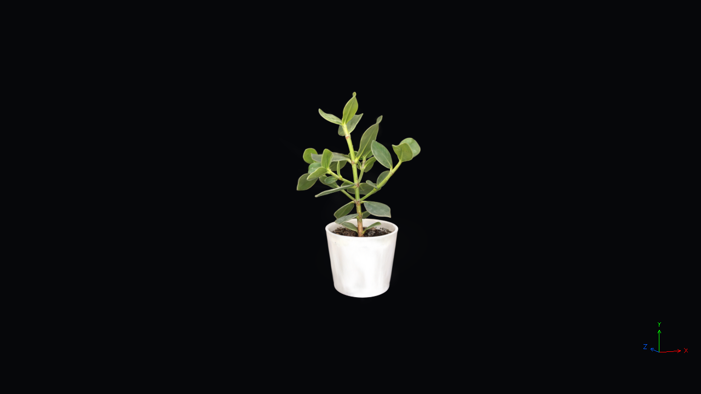

# Gaussian splatting in Lua

An interactive SH0 Gaussian splat viewer with a quaternion trackball and a small RGB world-axis gizmo drawn with `DrawLines`. **Metal is validated on macOS. DirectX 11 is the next qualification phase; OpenGL is not qualified.**



The bundled **Houseplant by Marcel Padilla** contains 113,648 Gaussians in a 3.64 MB `.splat` file, licensed under **CC BY 4.0**. See [source, license and modifications](resources/gaussian_splatting/ATTRIBUTION.md). No download, training, CUDA, or network access is needed to build or run this tutorial.

## Build and run on macOS

Use this branch's HARFANG build, including the new FabGen bindings. A previously installed `harfang` module will not have the compute API. The commands below assume an existing Release CMake configuration with `HG_BUILD_HG_LUA=ON`, `HG_BUILD_ASSETC=ON`, and `HG_BUILD_TESTS=ON`, a working `HG_FABGEN_PATH`, and the repository's usual dependencies. Run commands from the `harfang3d` repository root. Replace `../build/lua-cmake` with your build directory.

```sh
python3 tutorials/tools/run_gaussian_splatting.py \
  --build-dir ../build/lua-cmake --build --renderer metal
```

The helper builds `hg_lua`, Lua, `assetc` and `shaderc`, verifies the pinned asset SHA-256, converts all presets, compiles the shaders, and runs the viewer with the freshly built module. Subsequent runs may omit `--build`. Python uses only the standard library and runs offline preparation; the application itself is Lua.

| Control | Action |
|---|---|
| Left mouse drag | Quaternion trackball rotation around the target, including roll |
| Mouse wheel / trackpad scrolling | Dolly toward or away from the target |
| Right or middle mouse drag | Pan the target in the camera plane |
| R | Restore the initial framing, rotation and target |
| Escape / close window | Exit and release resources |

The camera ignores input when unfocused. The cursor remains visible. **There is no FPS mode.** The corner gizmo shows world **X in red, Y in green, Z in blue**, with line-drawn labels and arrowheads; it follows camera orientation and is drawn over the scene without depth testing. Window resize uses drawable pixels for rendering and client coordinates for the trackball, including Retina scaling.

Full quality is the default. For a smaller workload, add `--preset 60k` or `--preset 30k`. Spatial subsampling reduces opacity coverage and can introduce holes; these are quality/performance alternatives, not equivalent reconstructions.

A bounded run that closes automatically and saves a screenshot:

```sh
python3 tutorials/tools/run_gaussian_splatting.py \
  --build-dir ../build/lua-cmake --renderer metal --preset full \
  --frames 240 --capture --width 640 --height 360
```

On the tested Retina display, a 640×360 client window produces a 1280×720 drawable. The log and JSON report record the actual drawable dimensions. A normal interactive run has no artificial timeout; bounded tests have a subprocess watchdog.

## Source and generated files

| Location | Contents |
|---|---|
| `tutorials/gaussian_splatting.lua` | Resource setup, pass scheduling, input and shutdown |
| `tutorials/gaussian_splatting/camera.lua` | Pure Lua quaternion trackball math |
| `tutorials/gaussian_splatting/gizmo.lua` | Reusable line vertices for the RGB orientation overlay |
| `tutorials/resources/gaussian_splatting/source/` | Unmodified `.splat` and publisher metadata |
| `tutorials/resources/gaussian_splatting/shaders/` | Editable compute, Gaussian and gizmo shaders |
| `BUILD/gaussian_splatting/metal/generated/` | Converted blobs, metadata and staged shader includes |
| `BUILD/gaussian_splatting/metal/compiled/` | Runtime resources produced exclusively by `assetc` |
| `BUILD/gaussian_splatting/metal/` | Logs, preset JSON reports and optional PNG captures |

Generated files and compiled GPU binaries stay in the build directory. The helper stages the generated Lua metadata as `.luadata`, so `assetc` copies portable Lua source without requiring a bytecode compiler. The viewer loads only compiled resources. To run directly after compilation:

```sh
../build/lua-cmake/extern/lua/lua tutorials/gaussian_splatting.lua \
  --assets ../build/lua-cmake/gaussian_splatting/metal/compiled \
  --module ../build/lua-cmake/languages/hg_lua
```

Keep the entry script together with its `gaussian_splatting/` Lua modules. Prepared runtime distribution consists of these scripts, the matching Lua/HARFANG runtime, and the selected backend's compiled resources including attribution. No Python is needed at runtime.

## Rendering path

```text
Bulk SH0 float4 input (uploaded once)
  → project/cull anisotropic 3D covariance into 2D Gaussian ellipses
  → GPU bitonic sort, far to near with original-index tie breaking
  → gather three RGBA32F attribute atlases in sorted order
  → persistent ordered quad batches, Gaussian fragments and premultiplied alpha
  → RGB DrawLines gizmo
```

This is compute-assisted Gaussian splatting: compute performs projection, culling, ordering and attribute preparation; vertex/fragment shaders rasterize the ellipses. There is no per-splat Lua loop, CPU sorting, blocking readback, or geometry rebuilding in the normal frame loop. Screenshot and correctness readbacks occur only in explicit test/capture paths.

The 113,648-record preset pads to 131,072 keys. It uses 153 bitonic compare dispatches, plus projection and gather, then seven persistent quad batches and one gizmo draw. Each batch uses at most 16,384 quads and 16-bit indices. A sequential view preserves blend order between batches. Global compare passes use separate input/output buffers and separate views. All invalid entries use a trailing sentinel; original index gives deterministic equal-depth ordering.

**Measured prototype decision:** retain bitonic sorting for this small tutorial because the complete Metal workload meets the 16.7 ms target on the reference machine. It exceeds the original radix/view-budget target. Radix remains a future optimization for larger data or a slower backend, not an implemented feature or a portability guarantee.

The projection uses the perspective Jacobian and rotated anisotropic scales, adds a 0.3-pixel covariance floor, clips at three standard deviations, discards alpha below 1/255, clamps maximum alpha to 0.99, and caps each projected standard deviation at 256 pixels to bound near-camera overdraw. Centers behind the 0.05-unit near plane are discarded. These choices can produce near-camera clipping and approximation artifacts. Center-depth sorting is not exact ordering for intersecting ellipses. RGB/opacity are decoded directly from the source; there is no SH beyond degree 0, tone mapping, or additional gamma conversion.

The explicit persistent GPU payload for full quality is approximately **28.64 MiB**, excluding driver allocation overhead, transient gizmo vertices, backbuffers, and optional capture resources. Lua reports asynchronous whole-frame GPU times separately from CPU submission and wall-clock frame times. Per-pass GPU timings and visible-splat counters are not exposed yet.

## Data contract

The converter validates lengths, source hash, finite positions, positive linear scales, and normalized nonzero quaternions before writing any output. The `.splat` layout is `<6f8B`: XYZ, linear XYZ scale, RGB/opacity, and packed WXYZ quaternion. It applies a 180° X rotation, centers full bounds and normalizes full height to two units. No exponential or sigmoid is applied to already decoded source attributes.

Each HGS0 output has a 64-byte little-endian `<4sIII6f6I` header (magic, version, count, 64-byte stride, full transformed bounds, reserved zeros), followed by four float4 values per Gaussian: position/opacity, scale/padding, quaternion WXYZ, RGB/padding. File hashes cover the complete file including the header. Presets use 10-bit-per-axis Morton ordering and midpoint quantile sampling, retaining ascending original order. The JSON manifest records the transform, counts and hashes. The Lua loader checks header/version/count/stride and uploaded buffer size.

## Validation

```sh
# Offline converter: 19 tests.
python3 -m unittest discover -s tutorials/tools -p 'test_prepare_gaussian_splat.py'

# Native and Lua compute dependency chains, lifetime and shutdown.
python3 harfang/tests/run_compute_probe.py --build-dir ../build/lua-cmake --renderer metal --lua

# Full-sized GPU ordering: compare all 131,072 output IDs to Python's sorted result.
python3 harfang/tests/run_gaussian_sort_probe.py --build-dir ../build/lua-cmake

# End-to-end projection, equal-depth blending, culling, padding and screenshot pixels.
python3 tutorials/tools/check_gaussian_pipeline.py --build-dir ../build/lua-cmake
python3 tutorials/tools/check_gaussian_pipeline.py --build-dir ../build/lua-cmake --negative-control

# Trackball math: known rotation, reverse drag, focus, zoom, pan and long-drag stability.
../build/lua-cmake/extern/lua/lua harfang/tests/gaussian_camera.lua tutorials/gaussian_splatting/camera.lua

# Resize twice, capture and close normally.
python3 tutorials/tools/run_gaussian_splatting.py --build-dir ../build/lua-cmake \
  --frames 120 --resize-test --capture --width 640 --height 360

# Sustained reproducible route: orbit, close-ups, elevation changes and empty background.
python3 tutorials/tools/run_gaussian_splatting.py --build-dir ../build/lua-cmake \
  --preset full --frames 20000 --route --capture --width 640 --height 360
```

Performance samples exclude the first 60 frames. The report includes measured duration: choose enough frames to exceed 60 seconds on your hardware. GPU timestamps are asynchronous; duplicate timestamps are excluded. A zero GPU sample count means timing is unavailable or the warm-up was not completed, not zero GPU cost. The final capture adds work after normal sampling. Tests do not replace a human check of mouse/trackpad feel on each target machine.

See [implementation progress and measured results](../specifications/GSPLAT_PROGRESS.md) and the [original audit/roadmap](../specifications/SPECS_GAUSSIAN_SPLATTING_LUA_TUTORIAL_ROADMAP.md).

## Windows phase

Keep the current typed float4 buffers, unique binding stages, explicit dispatch dependencies and SH0 layout. On a Windows build, run the same native/Lua probe, GPU sort oracle, pixel oracle and viewer with `--renderer dx11`. The helper selects `DX11`/`windows` shader compilation and platform executable paths. This path has not been compiled or run on Windows here; success on Metal does not establish D3D11 support. The first Windows pass must also check quad batch ordering, resize, trackball input, normal shutdown and sustained performance. OpenGL qualification follows separately; macOS OpenGL is not the compute target.
